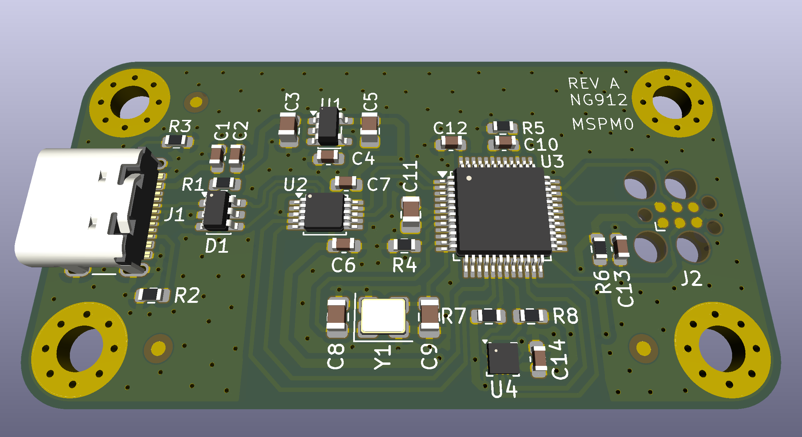

# MSPM0 Development board

A compact USB-C powered development board for the Texas Instruments MSPM0G3507 (Arm Cortex-M0+, LQFP-48), designed in KiCad from schematic to PCB layout. Two-layer, 56 × 28 mm. Alongside the microcontroller, the board carries a CH340E USB-UART bridge, an LIS2DH accelerometer on I²C, an 8 MHz crystal, a 3.3 V LDO regulator, and a Tag-Connect TC2030 footprint for SWD programming and debug. Built as a personal project.

Design complete with clean ERC and DRC; not planned for fabrication.

## Rendered PCB




## Schematic


The symbol and footprint for MSPM0 were created from its datasheet because no suitable library entry existed. Power supply, decoupling and clock circuitry follow the manufacturer's datasheet recommendations. The board uses a ground fill with stiching vias, and four M3 mounting holes with fiducials


## Repository contents

```
hardware/   KiCAD project files
docs/       Images and renders
```

## Tools

KiCAD
